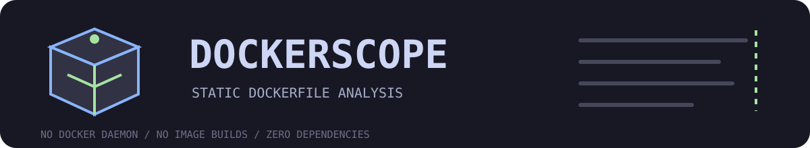

# DockerScope

<p align="center"></p>

**A zero-dependency static Dockerfile linter for security, image size and build reliability.**

DockerScope reads Dockerfiles as text. It never invokes Docker, builds images, pulls images, or executes instructions. Python 3.9+ is required; no pip installation is needed.

## Quick start

```bash
python dockerscope.py
python dockerscope.py Dockerfile
python dockerscope.py ./services
```

Read from standard input:

```bash
cat Dockerfile | python dockerscope.py -
```

## CI and output

```bash
python dockerscope.py ./services --format json
python dockerscope.py ./services --format github
python dockerscope.py ./services --fail-on error
python dockerscope.py --list-rules
```

Exit codes: `0` means the selected severity threshold was not reached, `1` means findings met `--fail-on`, and `2` means invalid input or no Dockerfiles were found.

Ignore a known exception for a single instruction:

```dockerfile
# dockerscope-ignore: DS001, DS015
FROM internal-build-image
```

Or filter rule IDs for one invocation with `--ignore DS001,DS015`.

## Rules

The 21 rules cover missing/unstable base-image tags, root users, apt/apk/pip layer hygiene, non-reproducible shell patterns, relative WORKDIR paths, unsafe remote-script piping, duplicate CMD/ENTRYPOINT, secrets in ARG/ENV, SSH exposure, missing HEALTHCHECK, sudo, deprecated MAINTAINER and world-writable permissions.

## Scope and limitations

Static linting is heuristic. It cannot resolve build arguments, inspect image contents, prove that a secret is real, or determine whether a HEALTHCHECK is appropriate for a particular service. Review findings in context. The tool does not replace image scanning, runtime configuration review, or container security testing.

## Development

```bash
python -m unittest discover -s tests -v
python -m py_compile dockerscope.py
```

## License

MIT. See [LICENSE](LICENSE).
